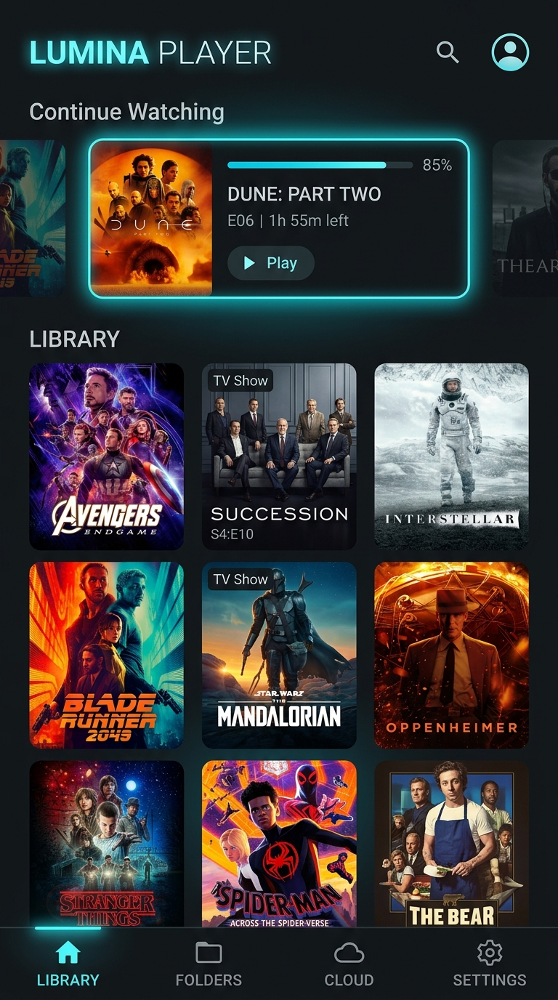
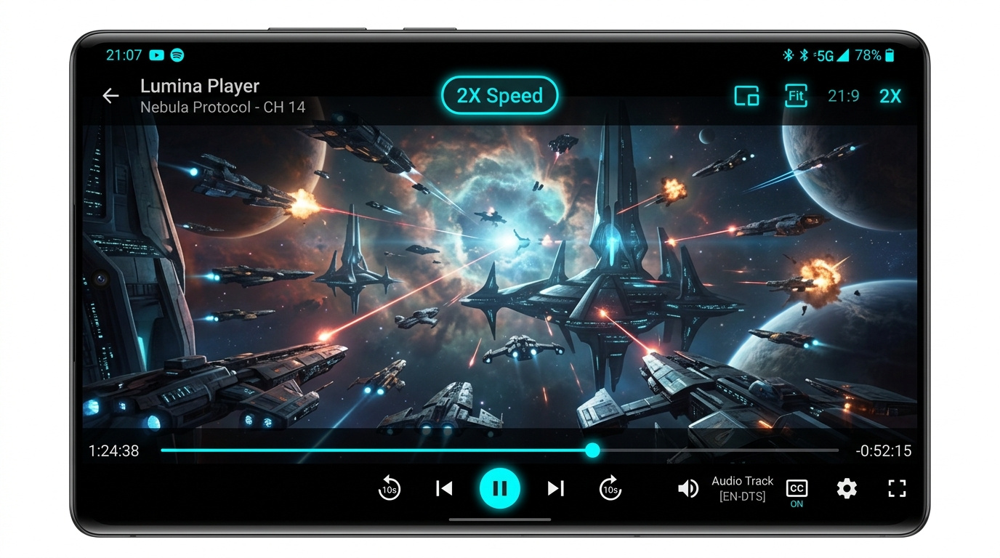

# Lumina Player

**Lumina Player** is a modern, high-performance local and network media player for Android built with Kotlin, Jetpack Compose (Material 3), Room, and AndroidX Media3 ExoPlayer.

---

## Direct APK Download (No Build Required)

Download the ready-to-install Android APK directly from this repository:

- **[Download LuminaPlayer.apk](releases/LuminaPlayer.apk)**

### How to Install the APK
1. Tap **[releases/LuminaPlayer.apk](releases/LuminaPlayer.apk)** on your Android device (or click **View raw** / **Download** in GitHub).
2. Open the downloaded `LuminaPlayer.apk` file from your Downloads notification or file manager.
3. If prompted, allow **Install unknown apps** for your browser or file manager.
4. Open **Lumina Player** -- the built-in **App Tutorial** and **AI API Setup Wizard** will walk you through permissions, automatic library watching, network storage, and AI setup.

---

## Features

- **Instant New-File Auto-Detection & Incremental Quick Scan**:
  - **Real-Time Watchers**: Uses `MediaStore` `ContentObserver` and folder-level `FileObserver` listeners, plus automatic `ON_RESUME` delta checks, so newly downloaded or copied videos appear without waiting on slow full rescans.
  - **O(1) Delta Indexing**: Skips already-indexed files and prunes deleted files automatically, running metadata enrichment concurrently only for new videos.
  - Toggle **Auto-Watch New Media Files** anytime under **Settings -> Playback & Localizations**, or tap the top-right **Quick Scan** button.
- **Step-by-Step In-App AI & API Setup + Interactive Tutorial**:
  - No `.env` edits or rebuilding required: tap the **AI Setup** icon in the Dashboard or go to **Settings -> Setup Wizards & App Guide -> AI API Wizard**.
  - Guided 4-step walkthrough explains how to get a free Gemini API key from Google AI Studio, includes one-tap clipboard paste, and runs a live **Test & Save** check before saving locally on your device.
  - Includes a 5-page **App Tutorial** explaining media permissions, instant scanning, network streaming, and player gestures.
- **Cloud & Network Storage Streaming (SMB, WebDAV, HTTP, Google Drive)**:
  - **SMB2 / SMB3 Shares**: Connect directly to Windows PCs, macOS file sharing, TrueNAS, Synology, or OpenWrt shares (`smb://` streaming with hardware-accelerated byte-range seeking and offline episode download).
  - **WebDAV & HTTP Directory Indexing**: Browse and stream directories over HTTP or HTTPS (including self-signed local certificates and Basic Auth credentials).
  - **Direct Stream URLs**: Add `.mp4`, `.mkv`, `.webm`, `.m3u8` (HLS), or `.mpd` (DASH) links.
  - **LAN Auto-Discovery**: Scan your local Wi-Fi subnet for live SMB (port 445) and WebDAV/HTTP media servers, then **Test Connection**, **Connect & Scan**, or **Browse & Play** folders interactively.
- **Advanced Subtitle Studio & Real-Time Sync**:
  - **Embedded Track Auto-Detection**: Lists embedded container subtitle tracks (SRT, ASS, VTT, PGS, VobSub) and auto-discovers sidecar subtitle files.
  - **Live Dynamic Offset Engine**: Scrub timing between `-5000ms` and `+5000ms` in real time with snap steppers (`-1.0s`, `-0.5s`, `0s`, `+0.5s`, `+1.0s`), micro steppers (`+/-50ms`, `+/-100ms`), and a live dialogue preview box.
  - **Attach, Download & AI CC**: Pick local `.srt` / `.vtt` files, fetch subtitles online, or generate AI closed captions using your configured Gemini API key.
  - **Custom Subtitle Styling**: Configure font family (Sans, Serif, Monospace), text size, background opacity, and color shades.
- **Gesture-Driven Playback Engine**:
  - **YouTube-Style Press-and-Hold 2X Speed**: Long-press anywhere on the video during playback for instant 2X speed; release to return to normal speed.
  - **Vertical Edge Swipes**: Swipe left half for brightness and right half for volume.
  - **Horizontal Seeking & Double-Tap**: Swipe horizontally for scrub previews or double-tap left/right to jump 10 seconds.

---

## Application Screenshots

<p align="center">
  
  &nbsp;&nbsp;&nbsp;&nbsp;
  
</p>

---

## Architecture & Tech Stack

- **UI Framework**: [Jetpack Compose](https://developer.android.com/jetpack/compose) with Material Design 3
- **Media Engine**: [AndroidX Media3 ExoPlayer](https://developer.android.com/guide/topics/media/media3) with `OkHttpDataSource` & custom `SmbDataSource`
- **SMB2/SMB3 Client**: [SMBJ](https://github.com/hierynomus/smbj)
- **Local Database**: [Room Database](https://developer.android.com/training/data-storage/room) with KSP
- **Networking**: [Retrofit](https://square.github.io/retrofit/), [OkHttp](https://square.github.io/okhttp/) & [Moshi](https://github.com/square/moshi)
- **Async & Reactive Flow**: Kotlin Coroutines & `StateFlow` / `SharedFlow`
- **Image Loading**: [Coil Compose](https://coil-kt.github.io/coil/)

---

## How to Use

### 1. First Launch & Tutorial
- Open **Lumina Player** to view the interactive **App Tutorial** explaining local indexing, auto-watch, network shares, and playback gestures.
- Tap **Quick Scan Device Storage** and grant video media access.
- Whenever you copy or download a new movie or episode later, **Lumina Player** automatically detects it via `ContentObserver` / `FileObserver` and incremental delta scan without redoing a full library rescan.

### 2. Setting Up Gemini AI & Metadata APIs (Optional, Inside the App)
- You do **not** need to hardcode keys or rebuild the app.
- Open **Settings -> Setup Wizards & App Guide -> AI API Wizard** (or tap the sparkle icon at the top of the Home screen).
- Follow the 4-step guide:
  1. Tap **Open Google AI Studio** in Step 2 to generate a free Gemini API key.
  2. Copy your key, tap **Paste from Clipboard** in Step 3, then tap **Test & Save Key** to verify it live.
  3. Optionally add a **TMDb** or **OMDb** API key in Step 4 for custom metadata and Fix Match search.

### 3. Streaming from Network Storage (PC / NAS / WebDAV)
- Open the **Network** tab on the bottom navigation bar.
- Choose **SMB Share**, **WebDAV / HTTP**, **Direct Stream URL**, or **Google Drive**.
- Tap **Scan Wi-Fi / LAN** to discover live SMB (port 445) or WebDAV/HTTP hosts on your local network, enter credentials if required, and tap **Test Connection** before **Connect & Scan**.
- Once connected, play videos directly from the Home screen, browse folders via **Browse & Play** on any connected server card, or download episodes offline.

### 4. Player Controls & Subtitle Studio
- **Press & Hold**: Long-press anywhere on the player for instant **2X** speed.
- **Open Subtitle Studio**: Tap **CC / Subtitles** in the player overlay to switch embedded or sidecar tracks, attach local `.srt`/`.vtt` files, adjust timing offsets live (`-5000ms` to `+5000ms`), or style font/size/opacity.

---

## Building from Source (Optional)

### Prerequisites
- **Android Studio**: Ladybug (2024.2.1) or newer
- **JDK**: Version 17
- **Android SDK**: Minimum SDK 24 (Android 7.0), Target SDK 36

### Build Steps
1. **Clone the Repository**:
   ```bash
   git clone https://github.com/your-username/LuminaPlayer.git
   cd LuminaPlayer
   ```

2. **Optional Build-Time `.env` Secrets**:
   If you prefer injecting default keys at build time instead of the in-app wizard:
   ```bash
   cp .env.example .env
   ```
   Leave `.env` empty or untracked; no API keys are included in this repository.

3. **Build the APK**:
   ```bash
   ./gradlew assembleDebug
   ```
   Or rely on the included GitHub Actions workflow (`.github/workflows/android-apk.yml`), which builds `app-debug.apk` on every push.

---

## Security & Privacy

- **No Hardcoded Keys**: Zero API credentials or secrets are committed to source control.
- **Local-First**: All metadata, playback history, server credentials, and configuration states remain on your device.

---

## License

```text
Copyright 2026 Lumina Player Contributors

Licensed under the Apache License, Version 2.0 (the "License");
you may not use this file except in compliance with the License.
You may obtain a copy of the License at

    http://www.apache.org/licenses/LICENSE-2.0

Unless required by applicable law or agreed to in writing, software
distributed under the License is distributed on an "AS IS" BASIS,
WITHOUT WARRANTIES OR CONDITIONS OF ANY KIND, either express or implied.
See the License for the specific language governing permissions and
limitations under the License.
```
